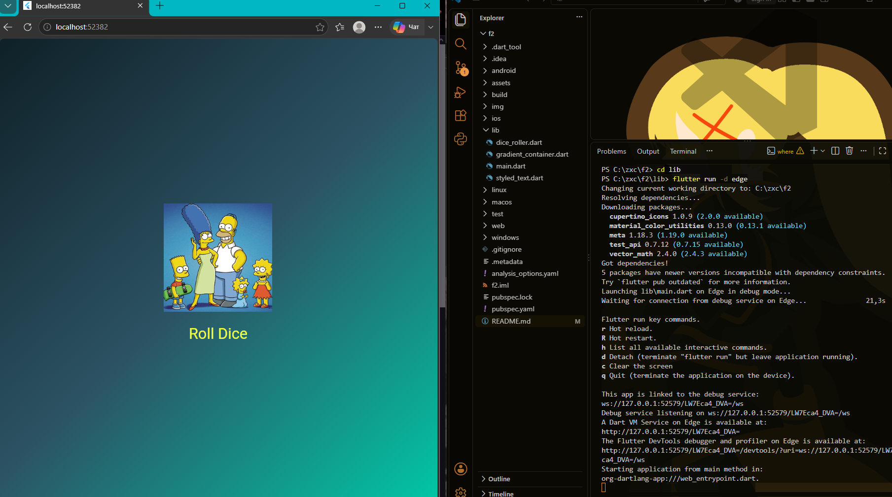
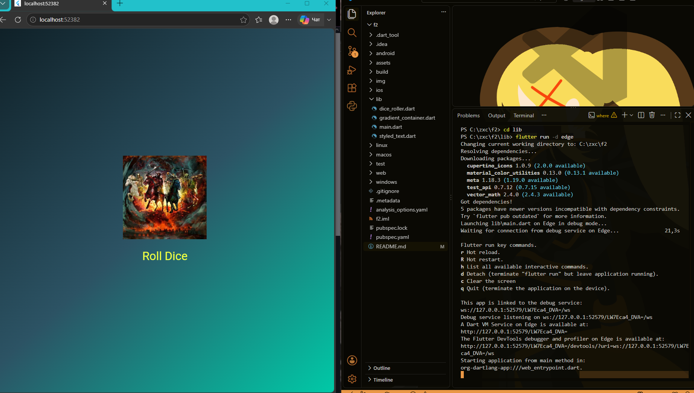

# Lab 4-5

**ФИО:** Эсмира Исенбекова
**Группа:** ИСП-241


## Описание

Приложение Roll Dice показывает игральную кость на градиентном фоне. При нажатии на кнопку **Roll Dice** случайным образом выбирается число от 1 до 6.

## Что изучено

- Построение интерфейса с помощью дерева виджетов Flutter.
- Создание собственных классов на основе `StatelessWidget` и `StatefulWidget`.
- Разделение виджетов по отдельным файлам и импортирование их.
- Передача данных в виджет через параметры конструктора.
- Работа с `assets`, генератором случайных чисел и `setState()`.

## Скриншот приложения






## Запуск

1. Установите Flutter SDK и убедитесь, что команда `flutter doctor` выполняется без критических ошибок.
2. Откройте папку проекта в терминале.
3. Установите зависимости:

   ```bash
   flutter pub get
   ```

4. Запустите приложение в Chrome:

   ```bash
   flutter run -d chrome
   ```

## Контрольные вопросы

### 1. Зачем выносить виджеты в отдельные файлы? Что изменится, если держать всё в `main.dart`?

Отдельные файлы упрощают чтение и поддержку кода, помогают находить нужные компоненты и повторно использовать их. Если хранить всё в `main.dart`, файл будет разрастаться, и код станет сложнее сопровождать.

### 2. Что такое `BuildContext`? Почему метод `build()` принимает его как параметр?

`BuildContext` содержит информацию о положении виджета в дереве виджетов. Он передаётся в `build()`, чтобы виджет мог обращаться к окружающему контексту приложения и связанным с ним возможностям Flutter.

### 3. Чем `StatelessWidget` отличается от `StatefulWidget`? Приведите пример, когда нужен каждый из них.

`StatelessWidget` используется, когда собственное изменяемое состояние не требуется, например для градиентного фона. `StatefulWidget` нужен, когда интерфейс должен изменяться в ответ на действия пользователя; в этой работе `DiceRoller` хранит текущее число на кубике.

### 4. Почему `Random()` создаётся на уровне файла, а не внутри `rollDice()`?

Так используется один общий генератор случайных чисел вместо создания нового объекта при каждом нажатии. Это позволяет повторно использовать генератор и не создавать его без необходимости.
